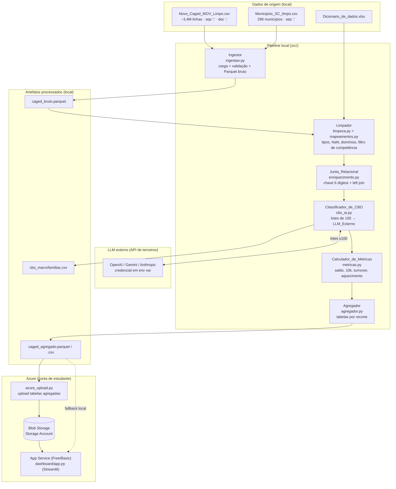
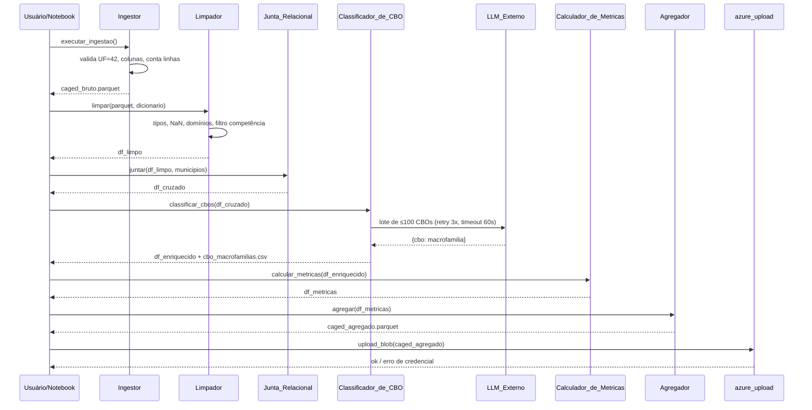

# Design Document

## Overview

Este documento descreve o design técnico do pipeline de dados e do dashboard analítico do Datathon CDIA 2026 — *"Raio-X do Mercado de Trabalho e Vagas Industriais em Santa Catarina"*. A solução responde à pergunta central de negócio: *quais regiões e setores industriais de SC enfrentam apagão de mão de obra ou expansão acelerada, e como renda e escolaridade explicam esses gargalos.*

### Objetivos

- **Ingerir e validar** ~3,4 milhões de linhas do CAGED movimentado de SC e os 296 municípios da Base_de_Municipios (R1).
- **Tratar e decodificar** tipos, valores ausentes e domínios categóricos para rótulos legíveis (R2).
- **Cruzar** CAGED × municípios por uma chave municipal normalizada de 6 dígitos (R3).
- **Calcular** métricas de negócio: Saldo_Liquido, Saldo_por_10k, Turnover, Indice_de_Aquecimento, salário médio de admissão/desligamento e distribuição de escolaridade (R4).
- **Enriquecer** os CBOs agrupando-os em macrofamílias via LLM_Externo executado localmente (R5).
- **Agregar** os dados em tabelas pequenas por recorte (região × setor × macrofamília × mês) (R6).
- **Publicar** um dashboard Streamlit com no mínimo 3 KPIs, mapa coroplético, ranking de setores e dispersão renda × escolaridade (R7).
- **Garantir reprodutibilidade**: execução ponta a ponta, dependências fixadas, credenciais em variáveis de ambiente, documentação de premissas (R8).
- **Implantar no Azure** dentro dos limites da conta de estudante: Blob_Storage para dados agregados, App_Service para o dashboard, com fallback local (R9).

### Princípios de design

1. **Agregar antes de servir.** O dashboard nunca lê os 3,4M de linhas; ele consome tabelas agregadas de poucos MB. O volume bruto é processado uma única vez no pipeline e persistido em Parquet.
2. **Separação de responsabilidades.** Cada etapa do pipeline é um módulo independente em `src/`, com entrada e saída bem definidas, o que facilita testes e substituição.
3. **Falha explícita e cedo.** Validações de schema, de credenciais e de integridade interrompem o pipeline antes de persistir estado parcial, registrando erros identificáveis.
4. **Determinismo auditável.** Exceto a chamada ao LLM_Externo (não determinística por natureza), todas as etapas são reprodutíveis a partir dos arquivos de origem. O prompt e o mapeamento CBO são versionados para auditoria.
5. **Resiliência da demonstração.** O dashboard tem fallback local caso o Blob_Storage esteja indisponível, para não bloquear a apresentação do pitch.

### Stack tecnológico (confirmado no ambiente)

| Camada | Tecnologia | Observação |
|---|---|---|
| Linguagem | Python 3.11.9 (pyenv) | Ambiente local confirmado |
| Processamento | Pandas 3.0.6 | Instalado |
| Formato colunar | `pyarrow` | **A instalar** (backend Parquet) |
| Gráficos | Plotly 7.1.0 | Instalado |
| Leitura do dicionário | `openpyxl` | **A instalar** (ler `.xlsx`) |
| Dashboard | Streamlit | **A instalar** |
| LLM | SDK do provedor (OpenAI/Gemini/Anthropic) | **A instalar**; API externa, credencial em env var |
| Azure | `azure-storage-blob` | **A instalar** (upload/download Blob) |

> `polars` é mencionado no plano como alternativa de performance, mas o design adota **Pandas + pyarrow** por já estar parcialmente instalado e por suficiência: a leitura pesada ocorre uma única vez, após o que o pipeline opera sobre Parquet. `libreoffice` e `unzip` estão disponíveis no sistema, mas não são dependências de runtime do pipeline.

## Architecture

### Visão de fluxo

O pipeline é linear e idempotente por etapa: cada componente lê o artefato da etapa anterior e grava o seu. O LLM_Externo roda **localmente** (na máquina que executa o pipeline), nunca no Azure. Somente as tabelas agregadas finais sobem para o Blob_Storage.



### Sequência de execução do pipeline



### Estrutura de pastas

```
DataThon/
├── Dados/                          # fontes originais (não versionar o CSV cru)
├── notebooks/
│   └── 01_pipeline.ipynb           # orquestra o pipeline ponta a ponta (R8.1)
├── src/
│   ├── ingestao.py                 # Ingestor (R1)
│   ├── limpeza.py                  # Limpador (R2)
│   ├── mapeamentos.py              # tabelas de domínio do dicionário (R2.5)
│   ├── enriquecimento.py           # Junta_Relacional (R3)
│   ├── cbo_ia.py                   # Classificador_de_CBO (R5)
│   ├── metricas.py                 # Calculador_de_Metricas (R4)
│   ├── agregador.py                # Agregador (R6)
│   └── azure_upload.py             # upload Blob Storage (R9)
├── data_processed/
│   ├── caged_bruto.parquet         # saída do Ingestor
│   ├── cbo_macrofamilias.csv       # mapeamento CBO → macrofamília (R5.4)
│   └── caged_agregado.parquet      # tabela agregada final (R6.3)
├── dashboard/
│   ├── app.py                      # Streamlit (R7)
│   └── geo/sc_municipios.geojson   # malha dos 295 municípios (scripts/baixar_malha_sc.py)
├── scripts/
│   └── baixar_malha_sc.py          # baixa a malha do IBGE e reescreve a chave p/ 6 dígitos
├── startup.sh                      # comando de inicialização do App Service (R9.2)
├── tests/                          # testes unitários e property-based
├── requirements.txt                # versões exatas fixadas (R8.2)
└── README.md                       # pré-requisitos e comandos (R8.8)
```

## Components and Interfaces

Cada módulo expõe funções puras sempre que possível (tratamento e cálculo), isolando efeitos colaterais (I/O de disco, chamada de API, upload) em funções de fronteira. Isso é o que viabiliza o property-based testing das métricas e das transformações.

### 1. Ingestor (`src/ingestao.py`) — R1

Responsável pela carga e validação de schema dos arquivos de origem e pela persistência do Parquet bruto.

```python
COLUNAS_OBRIGATORIAS_CAGED = [
    "competênciamov", "município", "seção", "subclasse", "saldomovimentação",
    "cbo2002ocupação", "graudeinstrução", "idade", "raçacor", "sexo",
    "salário", "valorsaláriofixo",
]

def ler_caged(caminho: str) -> pd.DataFrame:
    """Lê o CAGED com sep=';', decimal=',', encoding utf-8 (R1.1),
    descartando 'Unnamed: 0.1' e 'Unnamed: 0' (R1.3)."""

def ler_municipios(caminho: str) -> pd.DataFrame:
    """Lê a Base_de_Municipios com sep=',' (R1.2)."""

def validar_uf(df: pd.DataFrame) -> None:
    """Verifica uf == 42 (R1.4). Levanta ErroDeValidacao com a contagem
    de divergentes se houver qualquer linha != 42 (R1.5)."""

def validar_colunas(df: pd.DataFrame) -> None:
    """Verifica presença de COLUNAS_OBRIGATORIAS_CAGED (R1.6).
    Levanta ErroDeValidacao listando as ausentes (R1.7)."""

def executar_ingestao(caminho_caged: str, caminho_municipios: str,
                      destino_parquet: str) -> IngestResult:
    """Orquestra: lê arquivos (R1.10 se ausente/ilegível), valida (R1.4-1.7),
    registra contagem de linhas (R1.9) e persiste Parquet (R1.8).
    Não persiste se a validação falhar."""
```

- **R1.5/R1.7/R1.10**: validações levantam exceção antes de qualquer gravação; `executar_ingestao` só chama `to_parquet` após todas as validações passarem.
- **R1.9**: `IngestResult` carrega `linhas_caged` e `linhas_municipios`.

### 2. Limpador (`src/limpeza.py`) + domínios (`src/mapeamentos.py`) — R2

```python
def brl_para_float(valor: str | float) -> float:
    """Converte '2018,00' → 2018.00 com 2 casas (R2.1, R2.3).
    Retorna NaN se não for conversível (R2.2, R2.4)."""

def limpar_moeda(df, colunas: list[str]) -> tuple[pd.DataFrame, list[RegistroFalha]]:
    """Aplica brl_para_float a colunas monetárias; coleta (coluna, competência,
    qtde não convertida) para log (R2.2)."""

def decodificar_dominios(df, mapas: dict[str, dict]) -> tuple[pd.DataFrame, list[Nao Mapeado]]:
    """Substitui códigos por rótulos legíveis nas colunas categóricas (R2.5).
    Preserva o valor original e registra código/coluna/contagem quando não houver
    rótulo (R2.6). Células vazias → NaN (R2.7)."""

def filtrar_competencia(df, inicio=202509, fim=202608) -> tuple[pd.DataFrame, int]:
    """Mantém apenas competências no intervalo inclusivo (R2.8);
    retorna df filtrado e contagem de registros excluídos (R2.9)."""

def derivar_escolaridade_ordinal(df) -> pd.DataFrame:
    """Traduz o código de `graudeinstrução` para o nível ordinal, na coluna
    `escolaridade_ordinal` — eixo contínuo da dispersão de R7.4."""

def limpar(df_caged, df_municipios, mapas) -> LimpezaResult:
    """Orquestra todas as etapas de limpeza acima. A derivação do ordinal de
    escolaridade roda ANTES de `decodificar_dominios`, que substitui o código
    pelo rótulo."""
```

`mapeamentos.py` carrega do `Dicionario_de_dados.xlsx` (via `openpyxl`) e expõe os dicionários de domínio como constantes: `GRAU_INSTRUCAO`, `RACA_COR`, `SEXO`, `TIPO_MOVIMENTACAO`, `CATEGORIA`, `TAM_ESTAB_JAN`, `UNIDADE_SALARIO`, `SECAO_CNAE`.

### 3. Junta_Relacional (`src/enriquecimento.py`) — R3

```python
def chave_municipal_caged(codigo: str | int) -> str | None:
    """Normaliza para 6 dígitos numéricos (R3.1); None se malformado (R3.6)."""

def chave_municipal_ibge(codigo7: str | int) -> str | None:
    """Usa os 6 primeiros dígitos do IBGE de 7 dígitos (R3.2); None se malformado (R3.6)."""

def juntar(df_caged, df_municipios) -> JoinResult:
    """Left join preservando todo o CAGED (R3.3). Exclui registros com chave
    malformada e conta por base (R3.6). Registra nº sem correspondência e total (R3.4);
    emite alerta com códigos não correspondidos se > 1% (R3.5)."""
```

### 4. Classificador_de_CBO (`src/cbo_ia.py`) — R5

```python
MACROFAMILIAS = [  # conjunto pré-definido de 5 a 12 (R5.2)
    "Engenharia e Técnico", "Operacional de Produção", "Administrativo",
    "Logística e Transporte", "Tecnologia da Informação", "Comercial e Vendas",
    "Manutenção", "Saúde e Segurança do Trabalho", "Não classificado",
]

def extrair_cbos(df) -> list[str]:
    """CBOs distintos, descartando nulos/vazios (R5.1)."""

def montar_prompt(lote: list[str]) -> str:
    """Monta o prompt de classificação para um lote (R5.8)."""

def classificar_lote(lote: list[str], client) -> dict[str, str]:
    """Chama o LLM_Externo (retry ≤3, timeout 60s — R5.7). Valida que cada
    macrofamília pertence a MACROFAMILIAS; caso contrário 'Não classificado' (R5.6)."""

def classificar_cbos(df, client) -> ClassificacaoResult:
    """Divide em lotes de ≤100 (R5.3), agrega o mapeamento garantindo 1 linha por
    CBO (R5.4), persiste cbo_macrofamilias.csv + prompt (R5.8), faz merge na base
    e conta sem correspondência (R5.5). Executa localmente via API externa (R5.9)."""
```

### 5. Calculador_de_Metricas (`src/metricas.py`) — R4

Funções puras sobre DataFrames já cruzados e enriquecidos. Ver fórmulas na seção *Métricas de negócio*.

```python
def saldo_liquido(df, por: list[str]) -> pd.DataFrame: ...          # R4.1, R4.10
def saldo_por_10k(saldo_df, municipios) -> pd.DataFrame: ...        # R4.2, R4.3
def turnover(df, por: list[str]) -> pd.DataFrame: ...               # R4.4, R4.5
def salario_medio_por_movimentacao(df) -> pd.DataFrame: ...         # R4.6
def distribuicao_escolaridade(df) -> pd.DataFrame: ...              # R4.7
def indice_aquecimento(saldo_mensal_df) -> pd.DataFrame: ...        # R4.8, R4.9
```

### 6. Agregador (`src/agregador.py`) — R6

```python
def agregar(df_metricas, municipios) -> pd.DataFrame:
    """Uma linha por (região, Secao_Industrial, Macrofamilia_CBO, mês) (R6.1);
    omite combinações sem registros (R6.2); anexa população/IDHM/PIB (R6.6, R6.7);
    arredonda métricas a 2 casas (R6.5)."""

def exportar(df_agregado, destino: str) -> None:
    """Exporta Parquet/CSV (R6.3). Em falha, registra erro com destino e não grava
    arquivo parcial (R6.4)."""
```

### 7. azure_upload (`src/azure_upload.py`) — R9

```python
def upload_tabelas(caminho_local: str, container: str) -> None:
    """Lê credencial do Azure de env var (R8.5b, R8.7); interrompe sem enviar se
    ausente/inválida (R8.7, R9.3). Faz upload das tabelas agregadas (R9.1)."""
```

### 8. Dashboard (`dashboard/app.py`) — R7

O módulo resolve a raiz do projeto no `sys.path` antes de importar `src.*`: o
Streamlit coloca apenas a pasta do script no caminho de import, e o `main()` é
acionado pelo guard `if __name__ == "__main__"`, que o `streamlit run` satisfaz.

```python
def carregar_dados() -> pd.DataFrame:
    """Lê do Blob_Storage (R9.2); fallback para cópia local (R9.6).
    Se indisponível em ambos, sinaliza indisponibilidade (R7.8)."""

def aplicar_filtros(df, periodo, regiao, secao, macrofamilia) -> pd.DataFrame: ...  # R7.5
def render_kpis(df) -> None: ...          # R7.1, R7.6
def render_mapa(df, geojson) -> None: ... # R7.2
def render_ranking(df) -> None: ...       # R7.3
def render_dispersao(df) -> None: ...     # R7.4
```

## Data Models

### Schema do Parquet bruto (`caged_bruto.parquet`) — saída do Ingestor

Reflete o CAGED após descartar as colunas de índice, mantendo os nomes originais. Tipos aplicados na ingestão:

| Coluna | Tipo | Observação |
|---|---|---|
| `competênciamov` | int32 | AAAAMM |
| `município` | string | 6 dígitos |
| `seção` | category | seção CNAE A–T, Z |
| `subclasse` | string | subclasse CNAE |
| `saldomovimentação` | int8 | +1 admissão, -1 desligamento |
| `cbo2002ocupação` | string | código CBO |
| `graudeinstrução` | category | código de domínio |
| `idade` | int16 | — |
| `raçacor` | category | código de domínio |
| `sexo` | category | código de domínio |
| `salário` | float64 | ainda em texto BR na origem |
| `valorsaláriofixo` | float64 | ainda em texto BR na origem |
| `tamestabjan` | category | **código de faixa** de tamanho do estabelecimento (domínio de R2.5) |
| `uf` | int8 | validado = 42 |

> As colunas `indicadordeexclusão` e `competênciaexc` **não existem** neste arquivo — as exclusões já foram aplicadas na origem (R2.10, R8.3a). Documentado no README.

### Schema da Base_de_Municipios tratada

| Coluna | Tipo | Chave/uso |
|---|---|---|
| `Município` | string | nome |
| `Código` | string (7 díg.) | origem da Chave_Municipal |
| `chave_municipal` | string (6 díg.) | derivada p/ join (R3.2) |
| `População estimada - pessoas [2026]` | float64 | denominador de Saldo_por_10k (R4.2) |
| `IDHM [2010]` | float64 | indicador socioeconômico (desatualizado — R8.3b) |
| `PIB per capita - R$ [2023]` | float64 | indicador socioeconômico |

Valores `-` convertidos para NaN; números BR convertidos para float (R2.3, R2.4).

### Schema do mapeamento CBO → macrofamília (`cbo_macrofamilias.csv`) — R5.4

| Coluna | Tipo | Regra |
|---|---|---|
| `cbo2002ocupação` | string | único por linha (exatamente uma ocorrência) |
| `macrofamilia` | string | ∈ `MACROFAMILIAS` ou `Não classificado` |

Um arquivo irmão (ou cabeçalho comentado) registra o **prompt** utilizado (R5.8).

### Schema da tabela agregada (`caged_agregado.parquet`) — R6

Uma linha por combinação distinta de recorte; combinações sem registros são omitidas (R6.2).

| Coluna | Tipo | Origem |
|---|---|---|
| `regiao` | string | mesorregião do IBGE do município (atributo, não chave) |
| `municipio` | string | 6 dígitos — unidade do recorte (R6.1) |
| `secao_industrial` | string | rótulo CNAE |
| `macrofamilia_cbo` | string | R5 |
| `mes` | int32 | AAAAMM |
| `saldo_liquido` | float64 (2 casas) | R4.1 |
| `saldo_por_10k` | float64 (2 casas) \| NaN | R4.2/4.3 |
| `turnover` | float64 (2 casas) \| NaN | R4.4/4.5 |
| `indice_aquecimento` | float64 (2 casas) | R4.8 |
| `salario_medio_admissao` | float64 (2 casas) \| NaN | R4.6 |
| `salario_medio_desligamento` | float64 (2 casas) \| NaN | R4.6 |
| `escolaridade_media` | float64 (2 casas) \| NaN | R4.7 — nível ordinal médio dos admitidos, eixo da dispersão de R7.4 |
| `populacao_2026` | float64 \| NaN | R6.6 |
| `idhm_2010` | float64 \| NaN | R6.6 |
| `pib_per_capita_2023` | float64 \| NaN | R6.6 |

### Tabelas de domínio decodificadas (`mapeamentos.py`) — R2.5

Dicionários código → rótulo carregados do `Dicionario_de_dados.xlsx`. Exemplo de estrutura (valores ilustrativos; os reais vêm do dicionário):

```python
SEXO = {1: "Homem", 3: "Mulher"}
GRAU_INSTRUCAO = {1: "Analfabeto", 2: "Até 5ª incompleto", ...}
SECAO_CNAE = {"A": "Agropecuária", "B": "Indústria extrativa",
              "C": "Indústria de transformação", ...}
# RACA_COR, TIPO_MOVIMENTACAO, CATEGORIA, TAM_ESTAB_JAN, UNIDADE_SALARIO
```

## Métricas de negócio

Fórmulas implementadas em `metricas.py`, todas por recorte declarado. Admissão = `saldomovimentação == +1`, desligamento = `saldomovimentação == -1`.

### Saldo_Liquido (R4.1, R4.10)

Por recorte (município × Secao_Industrial × mês):

```
Saldo_Liquido = Σ saldomovimentação
```

Se o recorte não tem admissões nem desligamentos, `Saldo_Liquido = 0` (R4.10).

### Saldo_por_10k (R4.2, R4.3)

```
Saldo_por_10k = (Saldo_Liquido / populacao_2026) * 10_000    , se populacao_2026 > 0
Saldo_por_10k = NaN                                          , se populacao_2026 ausente ou == 0
```

### Turnover (R4.4, R4.5)

Por recorte (município × Secao_Industrial) no período set/2025–ago/2026:

```
admissoes      = contagem de saldomovimentação == +1
desligamentos  = contagem de saldomovimentação == -1
Turnover = min(admissoes, desligamentos) / max(admissoes, desligamentos)
Turnover = NaN     , se o recorte não tem admissão nem desligamento
```

O resultado está em `[0, 1]` **por construção** — o numerador é o menor dos dois
contadores e o denominador, o maior. Não há clamp.

**Por que o denominador não é o estoque de vínculos.** R4.4 nasceu pedindo
`min(adm, desl) / estoque`, a fórmula clássica de rotatividade. Esse estoque não
é recuperável do CAGED movimentado: o arquivo não traz identificador de
estabelecimento, então um estabelecimento com 50 movimentações aparece 50 vezes
e não há como saber que é o mesmo. A coluna `tamestabjan` tampouco serve — é o
**código da faixa** de tamanho (1 = "Zero", 5 = "De 20 a 49", 10 = "1000 ou
Mais"), não uma contagem. Medido sobre os 3,4 milhões de registros reais:

| denominador | mediana | saturados em 1,0 |
|---|---|---|
| ponto médio da faixa (média do recorte) | 1,000 | 62,7% |
| ponto médio da faixa (soma por linha) | 0,035 | 0,5% |
| `max(admissões, desligamentos)` | 0,851 | 9,0% |

O denominador adotado mede a mesma coisa e é identificável: sob o modelo natural
de que o volume de movimentação de um estabelecimento é proporcional ao seu
tamanho, o total de movimentações do recorte é proporcional ao seu estoque — e
`min/max` é a fórmula com estoque a menos de uma constante.

A leitura é direta e serve à pergunta de negócio: **1** é rotatividade pura
(admissões e desligamentos equilibrados, saldo nulo — a assinatura do apagão) e
**0** é crescimento ou encolhimento puro (só entrada ou só saída).

### Salário médio de admissão e de desligamento (R4.6)

Por Secao_Industrial, média aritmética de `salário` (R$, 2 casas), ignorando NaN:

```
salario_medio_admissao      = mean(salário | saldomovimentação == +1)
salario_medio_desligamento  = mean(salário | saldomovimentação == -1)
```

### Distribuição de escolaridade (R4.7)

Por Secao_Industrial, distribuição (contagem/proporção) de `graudeinstrução` separada entre admitidos e desligados.

### Indice_de_Aquecimento (R4.8, R4.9)

Por recorte, combina nível relativo e crescimento mês a mês:

```
variacao_mensal = Saldo_Liquido(mês) - Saldo_Liquido(mês anterior)
variacao_mensal = 0                            , se não há mês anterior no período (R4.9)
Indice_de_Aquecimento = Saldo_por_10k + variacao_mensal
```

Um índice alto e positivo indica expansão acelerada; fortemente negativo indica apagão.

## Normalização da chave municipal (R3.1, R3.2, R3.6)

O CAGED identifica municípios com **6 dígitos** (ex.: `420890`); a Base_de_Municipios usa o código IBGE de **7 dígitos** (ex.: `4200051`), cujo 7º dígito é verificador. A chave comum são os **6 primeiros dígitos**:

```
chave_caged = str(município).zfill(6)              # já tem 6 dígitos
chave_ibge  = str(Código)[:6]                      # descarta o verificador
```

Regras:
- Chave deve ser **numérica e ter exatamente 6 dígitos** após normalização; caso contrário o registro é malformado e excluído da junção, com contagem por base (R3.6).
- A junção é **left join** preservando todo o CAGED (R3.3). Municípios sem correspondência recebem NaN nos indicadores.
- Se o percentual de CAGED sem correspondência exceder 1%, emite-se alerta com os códigos não correspondidos e suas contagens (R3.5).

## Estratégia de agrupamento de CBOs via LLM (R5)

### Fluxo

1. Extrair CBOs distintos, descartando nulos/vazios (R5.1).
2. Particionar em **lotes de no máximo 100 códigos** (R5.3).
3. Para cada lote, chamar o LLM_Externo com um prompt que fixa o conjunto de macrofamílias (R5.2).
4. Validar a resposta: cada código deve mapear para **exatamente uma** macrofamília do conjunto; valores fora do conjunto viram `Não classificado` (R5.6).
5. Consolidar em um mapeamento com **uma linha por CBO** e persistir em CSV junto ao prompt (R5.4, R5.8).
6. Fazer merge na base e contar os CBOs sem correspondência (R5.5).

### Prompt (resumo do conteúdo)

O prompt instrui o modelo a atuar como classificador ocupacional, recebe a lista de códigos CBO 2002 do lote e o **conjunto fechado** de macrofamílias, e exige saída estruturada (JSON `{cbo: macrofamilia}`) sem texto extra, uma macrofamília por código, escolhendo `Não classificado` quando incerto. O prompt exato é persistido ao lado de `cbo_macrofamilias.csv` para auditoria.

### Conjunto pré-definido de macrofamílias (R5.2)

5 a 12 famílias, incluindo `Não classificado` como categoria de fallback — ver constante `MACROFAMILIAS`.

### Robustez (R5.6, R5.7)

- **Timeout** de 60 s por requisição; **retry** até 3 tentativas.
- Esgotadas as tentativas, todos os CBOs do lote recebem `Não classificado` e registra-se a falha.
- Resposta malformada, código ausente ou macrofamília inválida → `Não classificado`.

### Execução (R5.9, R8.6, R9.5)

O agrupamento roda **localmente** durante o pipeline, usando a API do provedor externo. A credencial vem de variável de ambiente (R8.5a); se ausente/vazia, o pipeline interrompe antes de chamar a API (R8.6). Azure OpenAI **não** é usado (indisponível na conta de estudante).

## Design do dashboard (R7)

Narrativa: **localizar o problema → entender a causa raiz → decidir.** O dashboard carrega apenas as tabelas agregadas (R7.7).

### Fonte de dados e fallback (R7.7, R7.8, R9.2, R9.6)

`carregar_dados()` tenta o Blob_Storage; em indisponibilidade, usa a cópia local em `data_processed/`. Se ambos falharem, exibe mensagem de indisponibilidade e **não** renderiza KPIs nem gráficos (R7.8).

### KPIs (R7.1)

No mínimo 3 KPIs com rótulo e valor numérico, derivados das métricas, por exemplo: Saldo líquido total do recorte, Saldo por 10k médio, Turnover médio. Quando o filtro não casa com nenhum registro, cada KPI exibe zero (R7.6).

### Visualizações

1. **Mapa coroplético de SC** (R7.2): colore cada município por `saldo_por_10k` usando a malha `geo/sc_municipios.geojson` (chave de 6 dígitos casando com `chave_municipal`). Escala **divergente** (negativo vs positivo distinguíveis) com legenda mostrando mín/máx.
2. **Ranking de setores** (R7.3): barras de Secao_Industrial ordenadas decrescentemente por `saldo_liquido`, exibindo `saldo_liquido` e `turnover`; destaque para a seção C.
3. **Dispersão renda × escolaridade** (R7.4): `salario_medio_admissao` vs `escolaridade_media` (nível ordinal médio dos admitidos — um eixo contínuo, que o rótulo textual de escolaridade não permitiria), segmentada por Secao_Industrial ou Macrofamilia_CBO.
4. **(Bônus)** série temporal do saldo mensal.

### Filtros (R7.5, R7.6)

Período, região, Secao_Industrial e Macrofamilia_CBO. Qualquer alteração recalcula KPIs e **todas** as visualizações sobre o subconjunto filtrado. Filtro vazio → KPIs em zero e indicação de ausência de dados em cada gráfico, sem encerrar o app.

## Implantação no Azure (R9)

### Componentes

- **Blob_Storage** (Azure Storage Account): guarda as tabelas agregadas (poucos MB). `azure_upload.py` faz o upload ao fim do pipeline (R9.1).
- **App_Service** (tier Free/Basic, SKU elegível para estudante): hospeda `dashboard/app.py`, lendo os dados do Blob_Storage (R9.2).

### Variáveis de ambiente (R8.5)

Duas credenciais distintas, nunca versionadas:
- `LLM_API_KEY` — credencial da API do LLM_Externo (R8.5a). Ausente/vazia → pipeline interrompe antes de chamar a API (R8.6).
- `AZURE_STORAGE_CONNECTION_STRING` (e correlatas) — acesso ao Azure (R8.5b). Ausente/vazia → etapa de upload interrompe antes de chamar o Azure (R8.7, R9.3), sem enviar dados parciais.

### Limites da conta de estudante (R9.4, R9.5)

Usar apenas SKUs elegíveis (Blob Storage padrão, App Service Free/Basic). **Não** usar Azure OpenAI — o agrupamento de CBOs roda fora do Azure (R9.5, documentado como premissa).

### Fallback local (R9.6)

Se o Blob_Storage estiver inacessível, o dashboard lê a cópia local das tabelas agregadas, preservando a demonstração.

## Error Handling

| Cenário | Requisito | Tratamento |
|---|---|---|
| Arquivo de origem ausente/ilegível | R1.10 | Erro identificando o arquivo; interrompe sem persistir |
| `uf` ≠ 42 | R1.5 | Erro com contagem de divergentes; interrompe sem persistir |
| Coluna obrigatória ausente | R1.7 | Erro listando cada coluna ausente; interrompe sem persistir |
| Valor monetário não conversível | R2.2 | Vira NaN; registra coluna/competência/contagem |
| Código categórico sem rótulo | R2.6 | Preserva original; registra coluna/código/contagem |
| Célula categórica vazia | R2.7 | Vira NaN; não interrompe as demais linhas |
| Competência fora do intervalo | R2.9 | Exclui registro; conta total excluído |
| Código municipal malformado | R3.6 | Exclui da junção; conta por base |
| Match municipal > 1% sem correspondência | R3.5 | Alerta com códigos e contagens |
| População ausente/zero | R4.3 | Saldo_por_10k = NaN |
| Recorte sem admissão nem desligamento | R4.5 | Turnover = NaN |
| Sem mês anterior | R4.9 | Componente de variação = 0 |
| Lote LLM falha/timeout (transitório) | R5.7 | Retry ≤3; depois `Não classificado` + log de falha |
| LLM recusa definitiva (400/401/403/404: saldo, credencial, modelo) | R5.7, R8.6 | Interrompe imediatamente com `ErroDeValidacao`, sem retry nem fallback — é configuração, e o fallback produziria um mapeamento vazio sem nada falhar |
| Mais de 50% dos CBOs em `Não classificado` | R5.6 | Log de ALERTA: o fallback deixou de ser caso de borda |
| Macrofamília inválida/ausente | R5.6 | `Não classificado` |
| Falha ao exportar agregação | R6.4 | Erro com destino; não grava arquivo parcial |
| Credencial LLM ausente | R8.6 | Interrompe antes da API externa; mensagem clara |
| Credencial Azure ausente/inválida | R8.7, R9.3 | Interrompe upload; sem dados parciais |
| Filtro sem registros | R7.6 | KPIs em zero; indicação de ausência; app segue |
| Tabelas agregadas indisponíveis | R7.8 | Mensagem de indisponibilidade; não renderiza |
| Blob inacessível | R9.6 | Fallback para cópia local |


## Correctness Properties

*Uma propriedade é uma característica ou comportamento que deve valer para todas as execuções válidas do sistema — essencialmente, uma afirmação formal sobre o que o sistema deve fazer. Propriedades são a ponte entre especificações legíveis por humanos e garantias de correção verificáveis por máquina.*

As propriedades abaixo resultam da análise de prework de cada critério de aceitação e da reflexão de consolidação (propriedades redundantes foram fundidas). Cobrem as partes do sistema amenas a property-based testing: funções puras de conversão, normalização, agregação, particionamento e filtragem. Renderização de UI, integração com Azure e checagens de documentação são cobertas por testes de exemplo/integração/smoke (ver Testing Strategy), não por PBT.

### Property 1: Validação de UF detecta e conta divergentes

*Para qualquer* DataFrame de CAGED, a validação de UF é aprovada se e somente se todas as linhas têm `uf == 42`; havendo divergências, a validação falha e reporta exatamente a quantidade de linhas com `uf != 42`.

**Validates: Requirements 1.4, 1.5**

### Property 2: Validação de colunas identifica exatamente as ausentes

*Para qualquer* subconjunto de colunas obrigatórias removido de um DataFrame de CAGED, a validação é aprovada se e somente se nenhuma coluna obrigatória falta, e em caso de falha o erro lista exatamente o conjunto de colunas ausentes.

**Validates: Requirements 1.6, 1.7**

### Property 3: Contagem de linhas lida é exata

*Para qualquer* arquivo de origem com N linhas de dados, a contagem de linhas registrada pelo Ingestor é igual a N.

**Validates: Requirements 1.9**

### Property 4: Round-trip de persistência Parquet

*Para qualquer* DataFrame válido persistido em Parquet pelo Ingestor, relê-lo produz um DataFrame com os mesmos dados e colunas (sem as colunas `Unnamed:*`).

**Validates: Requirements 1.3, 1.8**

### Property 5: Round-trip de conversão monetária BR ↔ float

*Para qualquer* número com 2 casas decimais, formatá-lo no padrão brasileiro (vírgula decimal) e convertê-lo de volta com `brl_para_float` recupera o valor original com precisão de 2 casas.

**Validates: Requirements 2.1, 2.3**

### Property 6: Valores inválidos e `-` tornam-se ausentes com contagem correta

*Para qualquer* sequência de valores misturando números BR válidos, strings não conversíveis e o marcador `-`, a conversão produz NaN exatamente nas posições inválidas/`-` e preserva as válidas, e a quantidade de não convertidos reportada é igual ao número de posições inválidas.

**Validates: Requirements 2.2, 2.4**

### Property 7: Decodificação de domínios mapeia conhecidos e preserva desconhecidos

*Para qualquer* sequência de códigos categóricos, cada código presente no dicionário de domínio é substituído pelo seu rótulo, cada código ausente do dicionário é preservado, e a contagem de códigos não mapeados reportada é igual ao número de códigos fora do dicionário.

**Validates: Requirements 2.5, 2.6**

### Property 8: Filtro de competência particiona corretamente pelo intervalo inclusivo

*Para qualquer* conjunto de registros com competências AAAAMM, os registros mantidos são exatamente aqueles no intervalo [202509, 202608] inclusive, os mantidos e os excluídos são disjuntos e sua união é o conjunto original, e a contagem de excluídos reportada é igual ao número de registros fora do intervalo.

**Validates: Requirements 2.8, 2.9**

### Property 9: Normalização da chave municipal produz 6 dígitos ou rejeita

*Para qualquer* código municipal de CAGED válido, a chave resultante é numérica de exatamente 6 dígitos; *para qualquer* código IBGE de 7 dígitos válido, a chave é igual aos seus 6 primeiros dígitos; códigos malformados produzem rejeição (None).

**Validates: Requirements 3.1, 3.2**

### Property 10: Left join preserva todo o CAGED válido

*Para qualquer* base CAGED e base de municípios, toda linha de CAGED com chave válida aparece no resultado do join exatamente uma vez, e indicadores municipais ausentes aparecem como NaN quando não há correspondência.

**Validates: Requirements 3.3**

### Property 11: Contagem de não correspondência e alerta de limiar são corretos

*Para qualquer* resultado de join, a quantidade reportada de registros sem município correspondente é igual ao número real de registros do CAGED sem match, o total reportado é igual ao número de registros do CAGED, e o alerta com os códigos não correspondidos é emitido se e somente se essa quantidade excede 1% do total.

**Validates: Requirements 3.4, 3.5**

### Property 12: Registros com chave malformada são excluídos e contados por base

*Para qualquer* base contendo códigos municipais malformados (comprimento diferente de 6 ou não numéricos), nenhum registro malformado aparece no resultado do join e a contagem de excluídos por base é igual ao número de registros malformados naquela base.

**Validates: Requirements 3.6**

### Property 13: Saldo_Liquido é o balanço de admissões e desligamentos

*Para qualquer* conjunto de movimentações (possivelmente vazio) em um recorte, o `Saldo_Liquido` é igual ao número de registros com `saldomovimentação == +1` menos o número com `saldomovimentação == -1`, sendo 0 para o conjunto vazio.

**Validates: Requirements 4.1, 4.10**

### Property 14: Saldo_por_10k segue a fórmula ou é ausente

*Para qualquer* saldo e população, o `Saldo_por_10k` é igual a `(saldo / populacao) * 10_000` quando a população é maior que zero, e é NaN quando a população é ausente ou zero.

**Validates: Requirements 4.2, 4.3**

### Property 15: Turnover está sempre em [0, 1] ou é ausente

*Para qualquer* número de admissões e desligamentos, o `Turnover` é igual a `min(admissões, desligamentos) / max(admissões, desligamentos)` quando o recorte tem ao menos uma movimentação, e é NaN quando não tem nenhuma. O resultado está em [0, 1] por construção.

**Validates: Requirements 4.4, 4.5**

### Property 16: Salário médio ignora ausentes e fica entre os extremos

*Para qualquer* vetor de salários contendo valores ausentes, o salário médio (de admissão ou de desligamento) é igual à média dos valores não ausentes e está entre o menor e o maior valor não ausente; inserir valores ausentes adicionais não altera a média.

**Validates: Requirements 4.6**

### Property 17: Distribuição de escolaridade soma ao total

*Para qualquer* recorte, a soma das contagens por grau de instrução dos admitidos é igual ao total de admitidos, e a soma das contagens dos desligados é igual ao total de desligados.

**Validates: Requirements 4.7**

### Property 18: Indice_de_Aquecimento é a soma de nível e variação mensal

*Para qualquer* série mensal de um recorte, o `Indice_de_Aquecimento` de um mês é igual ao `Saldo_por_10k` daquele mês mais a diferença de `Saldo_Liquido` em relação ao mês imediatamente anterior, e a componente de variação é zero no primeiro mês da série.

**Validates: Requirements 4.8, 4.9**

### Property 19: Extração de CBOs retorna distintos não vazios

*Para qualquer* coluna de códigos CBO, a lista extraída não contém duplicatas nem valores nulos/vazios e contém todo código não vazio presente na entrada.

**Validates: Requirements 5.1**

### Property 20: Loteamento respeita o limite de 100 e preserva o conjunto

*Para qualquer* lista de códigos CBO, todo lote gerado tem no máximo 100 códigos, os lotes são disjuntos e a concatenação dos lotes é igual à lista original.

**Validates: Requirements 5.3**

### Property 21: Mapeamento CBO é único e dentro do conjunto, com fallback

*Para qualquer* resposta do LLM_Externo, o mapeamento final contém cada código CBO exatamente uma vez, toda macrofamília atribuída pertence ao conjunto pré-definido, e todo código sem macrofamília válida (ausente ou fora do conjunto) recebe `Não classificado`.

**Validates: Requirements 5.2, 5.4, 5.6**

### Property 22: Contagem de CBOs sem correspondência no merge é exata

*Para qualquer* base cruzada e mapeamento CBO, a quantidade reportada de códigos sem correspondência é igual ao número real de códigos `cbo2002ocupação` da base ausentes no mapeamento.

**Validates: Requirements 5.5**

### Property 23: Integridade do agregado (unicidade e origem)

*Para qualquer* base de entrada, cada combinação `(municipio, secao_industrial, macrofamilia_cbo, mes)` aparece no máximo uma vez no agregado, e toda linha do agregado corresponde a pelo menos um registro de origem (combinações sem registros são omitidas). A coluna `regiao` (mesorregião do IBGE) é um atributo do município, constante dentro dele, e por isso não entra na chave — vários municípios compartilham a mesma região.

**Validates: Requirements 6.1, 6.2**

### Property 24: Round-trip de exportação do agregado

*Para qualquer* tabela agregada, exportá-la (Parquet ou CSV) e relê-la preserva os dados.

**Validates: Requirements 6.3**

### Property 25: Métricas do agregado têm no máximo 2 casas decimais

*Para qualquer* tabela agregada, cada métrica numérica (`saldo_liquido`, `saldo_por_10k`, `turnover`, `indice_aquecimento`, salários) é igual ao seu próprio valor arredondado a 2 casas decimais.

**Validates: Requirements 6.5**

### Property 26: Indicadores municipais anexados correspondem à base

*Para qualquer* recorte municipal, os indicadores de população 2026, IDHM 2010 e PIB per capita 2023 anexados são iguais aos da Base_de_Municipios para aquele município, ou NaN quando o município não possui o indicador.

**Validates: Requirements 6.6, 6.7**

### Property 27: Ranking de setores é ordenado de forma não crescente

*Para qualquer* conjunto de seções industriais com seus saldos, a ordem de saída do ranking é não crescente em `Saldo_Liquido`.

**Validates: Requirements 7.3**

### Property 28: Filtro do dashboard é correto e completo

*Para qualquer* base agregada e combinação de filtros (período, região, seção, macrofamília), todo registro no resultado satisfaz todos os critérios do filtro e nenhum registro que satisfaz os critérios é omitido.

**Validates: Requirements 7.5**

## Testing Strategy

### Abordagem dupla

- **Testes de propriedade (property-based):** validam propriedades universais das funções puras do pipeline — conversões, normalização de chave, métricas, loteamento, filtros e integridade de agregação (Propriedades 1–28).
- **Testes de exemplo (unit):** cobrem leituras de arquivos concretos (R1.1, R1.2, R1.10), controle de fluxo de retry do LLM (R5.7), persistência do prompt (R5.8), falhas de exportação (R6.4), renderização de KPIs e gráficos (R7.1, R7.2, R7.4, R7.7, R7.8), logging por etapa (R8.4) e guardas de credenciais (R8.6, R8.7, R9.3).
- **Testes de integração:** execução ponta a ponta do pipeline sobre um fixture pequeno (R8.1) e interação com o Blob_Storage via mock (R9.1, R9.2, R9.6).
- **Testes de smoke/checagens documentais:** premissas documentadas (R2.10, R8.3, R9.5), `requirements.txt` com versões fixadas (R8.2), README com seções exigidas (R8.8), leitura de credenciais só de env vars e ausência de segredos versionados (R8.5), SKUs elegíveis e ausência de Azure OpenAI (R9.4, R9.5, R5.9).

### Biblioteca e configuração de PBT

- **Biblioteca:** [Hypothesis](https://hypothesis.readthedocs.io/) (padrão de property-based testing em Python). Não implementar PBT do zero.
- **Runner:** `pytest` sobre o diretório `tests/`.
- **Iterações:** cada teste de propriedade executa **no mínimo 100 exemplos** (`@settings(max_examples=100)` ou superior).
- **Mocks:** a classificação de CBOs usa um cliente de LLM mockado nos testes de propriedade (Propriedades 21, 22) e nos de exemplo de retry, para isolar a lógica das chamadas de rede e manter custo baixo.
- **Geradores:** estratégias para DataFrames de CAGED sintéticos (competências ao redor dos limites, UFs mistas, códigos municipais válidos e malformados, salários BR válidos/ inválidos/`-`, CBOs com nulos e duplicatas) e para tabelas de municípios com indicadores ausentes.

### Rastreabilidade (tag obrigatória)

Cada teste de propriedade referencia sua propriedade de design via comentário no formato:

```
# Feature: datathon-caged-sc-pipeline, Property {número}: {texto da propriedade}
```

### Equilíbrio de testes

Os testes de exemplo focam em casos concretos, pontos de integração e condições de erro; a cobertura ampla de entradas é delegada aos testes de propriedade. Evita-se multiplicar testes de exemplo onde uma propriedade já garante a correção para todos os inputs.

### O que fica fora do PBT (e por quê)

- **Implantação no Azure (R9.1–R9.4):** comportamento de serviço externo e configuração de SKU; não há "para todo input" significativo — usa-se integração com mock e checagens de configuração.
- **Renderização do dashboard (R7.1, R7.2, R7.4):** layout/visual; usa-se testes de exemplo/snapshot.
- **Documentação e dependências (R2.10, R8.2, R8.3, R8.8, R9.5):** verificações textuais únicas (smoke).
- **Leitura de arquivos de origem concretos (R1.1, R1.2):** parsing de fixtures fixos (exemplo).
